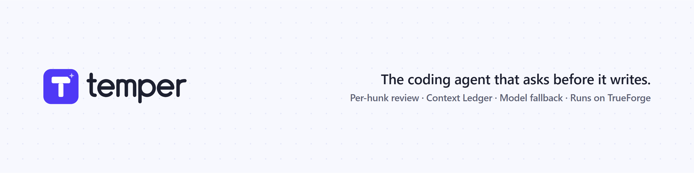
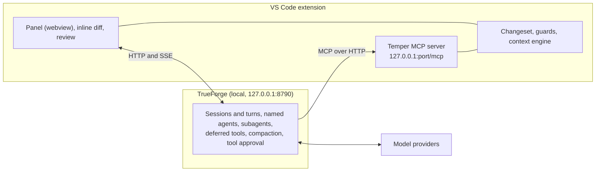

<p align="center"></p>

# Temper

A VS Code coding agent that edits across your project while you review every change hunk by hunk. The agent loop runs on a local [TrueForge](https://www.npmjs.com/package/@truefoundry/trueforge) server.

[](https://github.com/0xteamCookie/temper/actions/workflows/ci.yml)
[](LICENSE)
[](https://code.visualstudio.com/)

## What it does

- **Inline edit.** Select code, press `Ctrl+Alt+K`, describe the change. Proposed lines appear in the editor buffer under the lines they replace (nothing is saved), with Accept and Reject per hunk.
- **Agent mode.** Describe a task in the panel. The agent finds the files it needs, proposes edits across them, optionally runs allowlisted commands, and submits one changeset for review.
- **Context Ledger.** Attach code with `@file` and `@symbol`, or let the agent call `get_context`. Retrieval is budgeted in tokens, and the panel lists every item that went into the context, why it was chosen, and what it cost.
- **Per-hunk review with undo.** Proposed edits are held in memory. Disk is not written until you accept a hunk. Each apply is checkpointed and `Temper: Undo Last Agent Change` rolls it back.
- **Streaming and cancel.** Output streams as the turn runs, and `Temper: Stop` cancels the TrueForge session.
- **Safety checks.** The Scope Fence flags edits outside what you asked for (for inline edits, outside the selection). Symbol Check sends edits that reference unresolved symbols back to the agent. A model fallback chain retries, then moves to the next model; a failed attempt does not touch the workspace.

## Architecture



The extension never calls a model provider. It talks to TrueForge, and TrueForge calls Temper's MCP server for editor tools: `read_file`, `list_dir`, `search_code`, `find_symbol`, `get_context`, `propose_edit`, `create_file`, `submit_changeset` and `run_command`. `submit_changeset` requires approval, which opens the review. See [docs/architecture.md](docs/architecture.md).

## Requirements

- Node.js 22.14 or newer (TrueForge's minimum; CI runs Node 22) and npm
- VS Code 1.100 or newer
- git
- Python 3.10 or newer, only for the Flask demo project
- At least one model provider key (Anthropic, Gemini, OpenRouter, Groq, Vertex AI, a TrueFoundry gateway) or a local Ollama

## Install the prebuilt extension

The fastest way to try Temper, with no build:

1. Download `temper-0.1.0.vsix` from the [latest release](https://github.com/0xteamCookie/temper/releases/latest).
2. In VS Code: **Extensions** view → **⋯** → **Install from VSIX…**, or `code --install-extension temper-0.1.0.vsix`.
3. Open a project folder and the **Temper** view. Temper starts TrueForge for you (see below), then add a model provider from **Settings → Providers**.

Node.js 22.14 or newer must be on your `PATH`, because Temper runs TrueForge through `npx`.

## Quickstart

From a clean clone. Commands are for bash; the PowerShell equivalents are noted.

1. Install and build.

   ```bash
   git clone https://github.com/0xteamCookie/temper.git
   cd temper
   npm ci
   npm run build
   ```

2. Start TrueForge locally. You can skip this step: when Temper activates and nothing answers on `temper.trueforge.baseUrl`, it starts the pinned TrueForge itself as a background process (`npx -y @truefoundry/trueforge@0.185.0 --port 8790`, with `HOST=127.0.0.1` and `OUTBOUND_URL_ALLOWED_HOSTS` set and its database in VS Code's extension storage), streams its log to the **Temper** output channel and stops it when VS Code closes. Turn this off with `temper.trueforge.autoStart`. To run it yourself instead, use the script, which runs `npx -y @truefoundry/trueforge@0.185.0` with `HOST=127.0.0.1` and `OUTBOUND_URL_ALLOWED_HOSTS='["127.0.0.1"]'` (required so TrueForge may reach Temper's MCP server on localhost) and a SQLite file in `.trueforge/`. The first start downloads the package and can take 60 to 90 seconds.

   ```bash
   scripts/start-trueforge.sh    # PowerShell: .\scripts\start-trueforge.ps1
   ```

   To run it by hand instead: set `HOST=127.0.0.1` (TrueForge's default, `localhost`, resolves to `::1` on many Linux systems, where Temper cannot reach it) and `OUTBOUND_URL_ALLOWED_HOSTS='["127.0.0.1"]'`, then run `npx @truefoundry/trueforge@0.185.0`. It listens on `http://127.0.0.1:8790`. `scripts/stop-trueforge.sh` (or `.ps1`) stops the one the script started.

3. Run the extension. Open the folder in VS Code, press `F5`, and pick **Run Temper Extension**. In the Extension Development Host, open the Temper view from the activity bar. Temper connects to TrueForge on its own.

4. Add a model provider from the Providers screen (below), then optionally open the project you want to work on in that window, or set up the Flask demo (see [Reproducing the Round 1 tasks](#reproducing-the-round-1-tasks)).

### Add a provider in the editor

Open the Temper panel, then **Models** (the gear icon in the header). The **Providers** section lists OpenAI, Anthropic, Google Gemini, Fireworks, Together, Moonshot, Z.ai, Alibaba and an **OpenAI-compatible** entry for Ollama, LM Studio, OpenRouter, Groq and gateways.

- **Add key** asks for the key in a VS Code password prompt (never in the webview), lists the models that key can use, lets you tick the ones to keep (tool-capable models are preselected) and saves the provider into TrueForge. Temper stores no key anywhere: not in settings, not in SecretStorage, not in logs. Only TrueForge holds it.
- **Edit** changes the models or rotates the key. Leave the key empty to keep the one TrueForge already has.
- **Check** confirms TrueForge serves the provider's models and, if you paste the key, that the provider's model list accepts it. It never calls a model.
- **Remove** deletes the provider (and its stored key) from TrueForge after a confirmation.

If TrueForge is not running (for example, auto-start is off or the first start failed), the panel offers **Start TrueForge**, which starts the same managed background process, and **Retry**. A TrueForge you started yourself is always used as is, and Temper never stops it. The script and the managed process keep separate databases (`.trueforge/` in the repo versus VS Code's extension storage), so providers added under one are not visible to the other. Below the providers you can set the agent and inline models and reorder the fallback chain.

Temper only calls a provider's model-list endpoint, to show what is available. All inference goes through TrueForge.

### Headless / CI setup

Without the editor (CI, scripted demos), put keys in `.env` and run the script, which discovers models, applies [config/providers.json](config/providers.json) and registers them in TrueForge:

```bash
cp .env.example .env          # PowerShell: Copy-Item .env.example .env
node scripts/register-providers.mjs --check   # validate keys, read-only
node scripts/register-providers.mjs           # discover and register
```

Details in [Models and fallback](#models-and-fallback) and [config/README.md](config/README.md).

### Agent definitions

The two agent definitions are `agent/temper-agent.json` (agent mode, with dynamic subagents and context compaction) and `agent/temper-inline.json` (inline edits). You do not load them by hand. When Temper connects, it registers both in TrueForge as the named agents `temper-agent` and `temper-inline` (create, or update if they exist), with the model you selected for each mode, and creates every session by agent name. The files contain a `${MODEL}` placeholder, so posting them to TrueForge with `curl` fails. To use your own definitions, point `temper.trueforge.agent` and `temper.trueforge.inlineAgent` at files of the same shape. If registration fails, Temper logs it and runs from inline specs. Details in [agent/README.md](agent/README.md).

## Using Temper

| Action                                  | How                                                                     |
| --------------------------------------- | ----------------------------------------------------------------------- |
| Edit the selection                      | `Ctrl+Alt+K` (`Cmd+Alt+K` on macOS), or `Temper: Edit Selection`        |
| Add selection to chat                   | `Ctrl+Alt+L` (`Cmd+Alt+L`), or the editor context menu                  |
| Accept or reject the hunk at the cursor | `Ctrl+Alt+Y` / `Ctrl+Alt+N` while an inline diff is open                |
| Dismiss the inline diff                 | `Esc`                                                                   |
| Open the panel                          | Temper icon in the activity bar, or `Temper: Open Panel`                |
| Stop the running turn                   | `Temper: Stop`                                                          |
| Undo the last applied agent change      | `Temper: Undo Last Agent Change`                                        |
| Choose a model                          | `Temper: Select Model`, the status bar item, or the panel's Models view |
| See the session in TrueForge            | `Temper: Open Session in TrueForge`                                     |
| Diagnose problems                       | `Temper: Show Log`                                                      |

Inline hunks also have `Temper: Accept All Hunks`, `Reject All Hunks` and `Open Side-by-Side Diff` in the Command Palette while a diff is open. In agent mode, the Review view in the panel lists each file and hunk with Accept and Reject, and opens a diff tab per file.

## Configuration

All settings are under `temper.*`. API keys never go in settings.

| Setting                               | Default                                                 | Meaning                                                    |
| ------------------------------------- | ------------------------------------------------------- | ---------------------------------------------------------- |
| `temper.trueforge.baseUrl`            | `http://127.0.0.1:8790`                                 | TrueForge server root                                      |
| `temper.trueforge.agent`              | `""`                                                    | Agent spec file for agent mode (empty = bundled)           |
| `temper.trueforge.inlineAgent`        | `""`                                                    | Agent spec file for inline edits (empty = bundled)         |
| `temper.models.chain`                 | `[]`                                                    | Ordered fallback chain of TrueForge model names            |
| `temper.models.agentMode`             | `""`                                                    | Model for agent mode (empty = first in chain)              |
| `temper.models.inlineEdit`            | `""`                                                    | Model for inline edits (empty = first in chain)            |
| `temper.models.fallback.enabled`      | `true`                                                  | Move to the next model when a request fails                |
| `temper.models.fallback.retries`      | `1`                                                     | Retries on the same model before falling back (0-5)        |
| `temper.context.budgetTokens`         | `0`                                                     | Context token budget (`0` = adaptive)                      |
| `temper.context.budgetPercent`        | `25`                                                    | Share of the model's window used when adaptive             |
| `temper.context.exclude`              | `.git, node_modules, dist, out, .venv, __pycache__`     | Excluded from indexing and context                         |
| `temper.review.mode`                  | `endOfRun`                                              | `endOfRun` or `perEdit`                                    |
| `temper.commands.allowlist`           | `pytest, python -c, git diff, git status, flask --help` | Command prefixes the agent may run; others refused         |
| `temper.commands.runInShadowWorktree` | `true`                                                  | Run commands in a throwaway copy including pending changes |
| `temper.guards.scopeFence`            | `flagAndReject`                                         | `flagAndReject`, `block`, `warn`, `off`                    |
| `temper.guards.symbolCheck`           | `bounceThenWarn`                                        | `bounceThenWarn`, `bounce`, `warn`, `off`                  |
| `temper.mcp.port`                     | `0`                                                     | Port of the MCP server on `127.0.0.1` (`0` = free)         |
| `temper.ui.showLedger`                | `true`                                                  | Show the Context Ledger in the panel                       |
| `temper.pricing.fetch`                | `true`                                                  | Fetch model prices from models.dev (at most once a day)    |
| `temper.pricing.overrides`            | `{}`                                                    | Your own prices per model, USD per 1M tokens               |

## Models and fallback

In the editor, use the Providers screen (see [Add a provider in the editor](#add-a-provider-in-the-editor)). The rest of this section describes the headless path, `.env` plus the script, which has four layers, each with one job:

1. **Secrets.** `.env` (git-ignored; template in [.env.example](.env.example)) holds API keys and endpoint URLs only.
2. **Discovery.** `scripts/register-providers.mjs` asks each configured provider which models your key can use.
3. **Policy.** [config/providers.json](config/providers.json) (committed, no secrets) says which models to keep: pinned ids, or filters such as tool support and minimum context.
4. **Registration.** The script registers the selection in TrueForge. Use `--dry-run` to preview and `--check` to validate keys without registering.

Registered models show up in TrueForge as `<provider>/<alias>` and in Temper's model list. [config/models.example.json](config/models.example.json) is an example chain and per-mode picks, with the matching `temper.models.*` setting for each field; see [config/README.md](config/README.md). Copy the values into your VS Code settings, or set the chain in the panel's Models view.

When a request fails, Temper retries on the same model `temper.models.fallback.retries` times, then replays the turn on the next model in the chain. A failed turn has produced no workspace changes, so the replay is safe.

## Usage and cost

Each finished run shows its tokens and an estimated cost (`12.4k in · 1.8k out · ≈ $0.03 · claude-sonnet-5-5`), and a session total sits above the composer. TrueForge reports tokens but no prices, so Temper prices them itself from the [models.dev](https://models.dev) index (MIT). It downloads the index at most once a day, keeps only the price and context size of each model, and falls back to a small bundled snapshot offline (`scripts/update-pricing-snapshot.mjs` regenerates it). Cost counts cached input at the cache price and sums per model when a run falls back to another one. Local Ollama models show as free; models with no known price show `—`, not $0. Costs are estimates, not a bill. Set `temper.pricing.fetch` to `false` to stop the download, and `temper.pricing.overrides` to price a model yourself.

## Reproducing the Round 1 tasks

The tasks run against `pallets/flask` tag 3.1.3.

```bash
scripts/setup-flask-demo.sh           # PowerShell: .\scripts\setup-flask-demo.ps1
```

This clones Flask into `../flask` (or the directory you pass), checks the commit, and creates `.venv` with Flask installed in editable mode and `pytest<9`. Open that folder in the Extension Development Host, then use agent mode or `Ctrl+Alt+K` as the task requires. The task prompts themselves are not stored in this repository.

For the model-failure scenario, register a provider that points at a dead port, put it first in the chain, run a task, and watch Temper fall back:

```bash
node scripts/demo-task-c.mjs break     # adds unreachable/primary
node scripts/demo-task-c.mjs restore   # removes it
```

Add `unreachable/primary` to `temper.models.chain` before the run and remove it after `restore`.

## Starting point

Temper is built from scratch; there is no fork. A small number of files and patterns are adopted from other open-source projects:

- the edit replacer chain in `extension/src/changeset/replacers.ts` is derived from opencode (MIT);
- the review diff views follow Cline's diff content provider and multi-file diff pattern (Apache-2.0), re-implemented;
- the in-buffer inline diff follows Continue's vertical diff design (Apache-2.0), written from scratch with no upstream source copied.

The exact files, upstream references and licence texts are in [THIRD_PARTY_NOTICES.md](THIRD_PARTY_NOTICES.md). Upstream licences are preserved there and in each adopted file's header.

## Project layout

```text
agent/                 TrueForge agent definitions (temper-agent.json, temper-inline.json)
config/                providers.json (policy), models.example.json
docs/                  architecture notes
extension/
  src/                 extension host: trueforge, mcp, context, changeset, guards, inline, review, host
  webview-ui/          React and Vite panel
  test/                vitest suites
scripts/               start/stop TrueForge, register providers, Flask demo setup
.github/               CI, Dependabot, issue and PR templates
```

## Development

| Command                               | Purpose                                    |
| ------------------------------------- | ------------------------------------------ |
| `npm run build`                       | Build the extension and the webview        |
| `npm run watch`                       | Rebuild on change                          |
| `npm test`                            | Run the vitest suites                      |
| `npm run lint`                        | ESLint                                     |
| `npm run typecheck`                   | TypeScript checks for both workspaces      |
| `npm run format:check`                | Prettier check                             |
| `npm run package`                     | Build and produce a `.vsix`                |
| `npm run dev -w extension/webview-ui` | Webview in a browser with demo data (Vite) |

See [CONTRIBUTING.md](CONTRIBUTING.md).

## Team

teamDelulutoSolulu(), Team ID TM-FCDD34F48A3: [0xPixelNinja](https://github.com/0xPixelNinja), [pranjal-kumar-0](https://github.com/pranjal-kumar-0), [Kathrina-dev](https://github.com/Kathrina-dev). Entry for the TrueFoundry Forge-a-thon, Techfest IIT Bombay 2026-27.

## Contributing, security, license

- [CONTRIBUTING.md](CONTRIBUTING.md) and the [Code of Conduct](CODE_OF_CONDUCT.md)
- [SECURITY.md](SECURITY.md)
- [Apache-2.0](LICENSE); third-party notices in [THIRD_PARTY_NOTICES.md](THIRD_PARTY_NOTICES.md)
